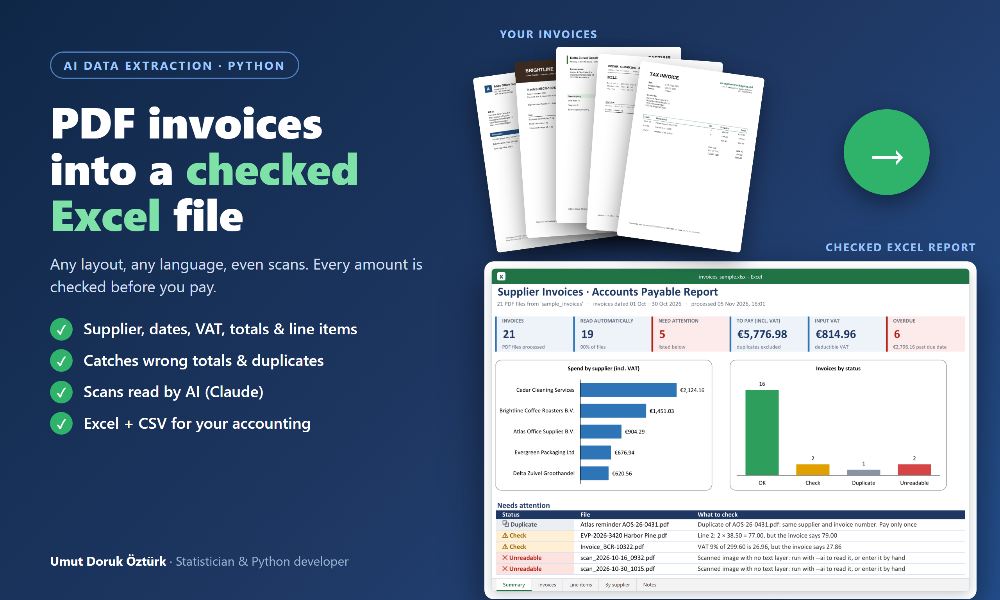
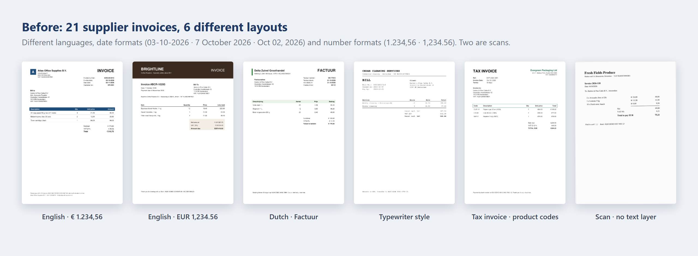
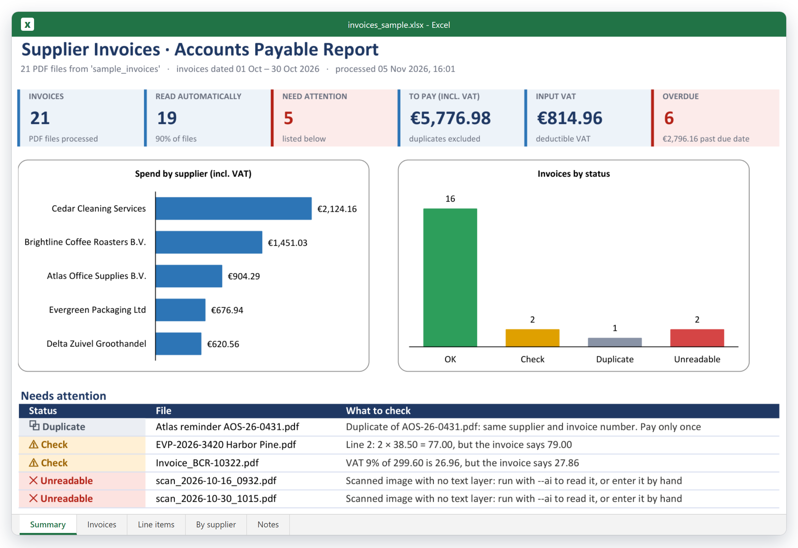
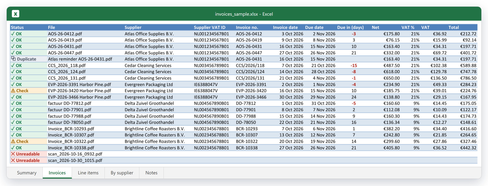
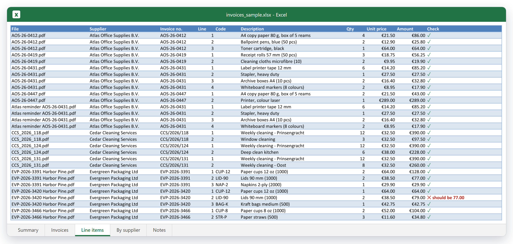
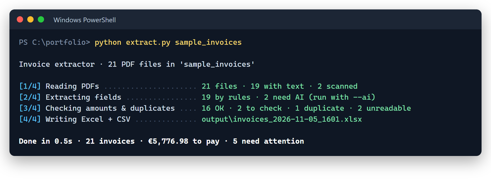

# PDF Invoices → Checked Excel: AI Invoice Extractor

**Reads supplier invoices in any layout (English, Dutch or German, digital or scanned) and turns them into one checked Excel file. Every amount is verified before anything gets paid.**



---

## The problem

> *"We get about 200 supplier invoices a month as PDFs. Someone types them into Excel by hand. It takes days, typos slip through, and last month we paid the same invoice twice."*

Every supplier uses a different layout, language, date format and number format. Some invoices are scans with no text at all.

## The result

| | |
|---|---|
| **Invoices processed** | 21 PDFs from 6 suppliers, 6 different layouts |
| **Read automatically** | 19 of 21 without AI. The 2 scans need the AI step |
| **Problems caught** | 1 duplicate (a re-sent reminder), 1 wrong line total, 1 wrong VAT amount |
| **Run time** | under 1 second (rules only) |
| **Output** | Excel report with 5 sheets + 2 CSV files ready for accounting software |

📥 **[Download the sample Excel file](sample_output/invoices_sample.xlsx)** · [invoices CSV](sample_output/invoices_sample.csv) · [line items CSV](sample_output/line_items_sample.csv) · [the sample invoices](sample_invoices/)

### Before: invoices as they arrive



### After: one checked Excel file

**Summary**: totals, VAT, overdue invoices and a list of exactly what needs a human.



**Invoices**: one row per invoice with status, dates, days until due (red = overdue) and amounts.



**Line items**: every product line, with quantity × price checked on each one.



---

## What gets checked

Reading the numbers is half the job. The other half is making sure they're right:

| Check | Example from the sample |
|---|---|
| Quantity × unit price = line amount | *Line 2: 2 × 38.50 = 77.00, but the invoice says 79.00* |
| Line items add up to the subtotal | |
| VAT % of the subtotal = VAT amount | *VAT 9% of 299.60 is 26.96, but the invoice says 27.86* |
| Subtotal + VAT = total | |
| Same supplier + invoice number seen before | *Duplicate of AOS-26-0431.pdf. Pay only once* |
| Required fields found (supplier, number, date, total) | |
| Due date passed | shown in red in *Due in (days)* |

## How it works

```
PDF ─► text layer? ──yes──► rules: find fields by their labels (EN / NL / DE), whatever the layout
            │                         │
            no (scan)                 missing fields?
            │                         │
            └──────────► AI (Claude): reads the page like a person, returns structured JSON
                                      │
                      same checks for every invoice ─► Excel report + CSV files
```

- **Rules first**: fast, free and exact for invoices that have a text layer. Labels such as *Invoice number*, *Factuurnummer*, *Bill No.* and *Ref* are recognised wherever they appear on the page, along with dates like `03-10-2026`, `7 October 2026` and `Oct 02, 2026` and amounts like `1.234,56`, `1,234.56` and `EUR 1234.56`.
- **AI for the rest** (optional, `--ai`): scans and unusual layouts are sent to Claude, which returns the fields in a fixed JSON structure. AI results go through **the same checks**, so an AI mistake is caught the same way a supplier's typo is.
- **Nothing is paid twice**: duplicates are matched on supplier VAT number + invoice number.



## Run it yourself

```bash
pip install -r requirements.txt
python extract.py sample_invoices          # rules only, no API key needed
python extract.py sample_invoices --ai     # also read the scans with Claude (set ANTHROPIC_API_KEY)
```

Or put your PDFs in an `invoices` folder and double-click `run.bat`. Set your own company name and VAT number in [`invoice_extractor/config.py`](invoice_extractor/config.py) so they're never mistaken for the supplier.

Run the tests with `python -m pytest` (31 tests, including the AI step against a mocked API, so no key is needed).

## Project structure

```
invoice-extractor-ai/
├── extract.py                    # command-line entry point
├── run.bat                       # double-click launcher for Windows
├── invoice_extractor/
│   ├── pdf_text.py               # reads the PDF text layer
│   ├── rules.py                  # label-based extraction, any layout
│   ├── numbers.py                # amounts & dates in European and US formats
│   ├── ai.py                     # Claude step: PDF in, validated JSON out
│   ├── validate.py               # arithmetic checks, duplicates, status
│   ├── excel_report.py           # Excel report + CSV exports
│   └── config.py                 # your company name / VAT number, AI model
├── tests/                        # 31 pytest tests
├── sample_invoices/              # 21 fictional invoices
├── sample_output/                # the files shown above
└── tools/make_sample_invoices.py # generates the sample invoices
```

**Tech:** Python · pdfplumber · Claude API (structured outputs) · pydantic · openpyxl · pytest

## About the sample

- All 21 invoices are **fictional**: made-up suppliers, VAT numbers and bank details, generated by [`tools/make_sample_invoices.py`](tools/make_sample_invoices.py). Three contain problems on purpose so you can see the checks work.
- The sample report was made **without** the AI step, so the two scans are listed as *Unreadable*. With `--ai` and an API key they are read by Claude and checked like the others.
- *Overdue* is calculated on the day the report was made (5 November 2026).

---

## Need something like this?

I build document automation for businesses: **invoices, receipts, purchase orders, contracts, bank statements, forms**. Your PDFs become clean Excel, CSV or Google Sheets files, checked for errors, with AI only where it's needed.

**Umut Doruk Öztürk** · Statistician (METU) & Python developer
[Upwork](https://www.upwork.com/freelancers/YOUR-PROFILE) · [Fiverr](https://www.fiverr.com/YOUR-USERNAME) · [LinkedIn](https://www.linkedin.com/in/umut-doruk-ozturk)
